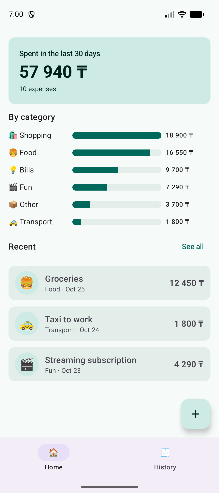
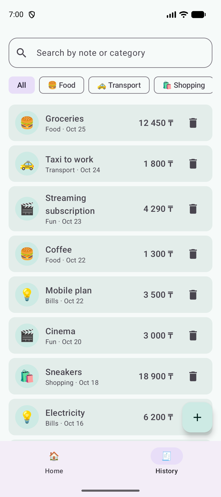
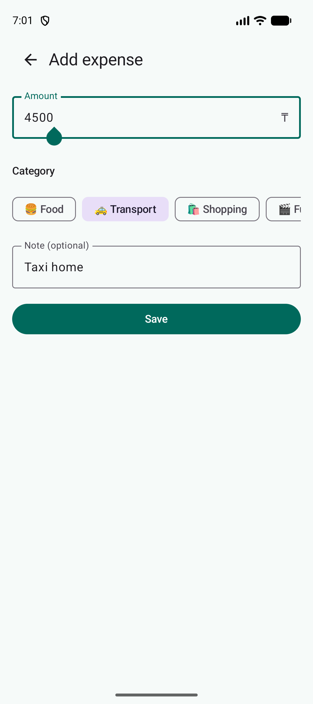

# Qarjy — simple expense tracker (Android, Kotlin + Jetpack Compose)

Qarjy (*қаржы* — "finance") helps you see where your money goes: add an expense in a few taps,
browse and filter your history, and check how much you spent in the last 30 days by category.
Amounts are in Kazakhstani tenge (₸).

> Midterm Project, Part 1 — Mobile Programming (Android).
> Data is stored in memory for now; a database is planned for the second half of the semester.

## Screenshots

| Home | History | Add expense |
|---|---|---|
|  |  |  |

## Features

1. **Add an expense** — amount (digits only, validated), category chips, optional note. The *Save* button is
   enabled only for a valid amount.
2. **Browse and manage history** — newest first, search by note or category, filter by category chip,
   delete an expense.
3. **Spending summary** — total for the last 30 days and a bar per category on the Home screen,
   plus the three most recent expenses. Everything updates immediately after adding or deleting.

## Screens and navigation (Navigation Compose)

| Screen | Route | How you get there |
|---|---|---|
| Home | `home` (start) | bottom bar |
| History | `history` | bottom bar, or "See all" on Home |
| Add expense | `add` | floating "+" button on Home / History; Save or Back returns to the previous screen |

Home and History are tabs of the bottom `NavigationBar` (tab state is saved and restored).
Add expense is a full-screen form, so the bar and the "+" button are hidden there.

## Architecture

```
data/      Models.kt (Category, Expense), ExpenseRepository.kt   – data + in-memory storage
ui/        QarjyViewModel.kt (QarjyUiState + StateFlow)           – state and logic
           QarjyApp.kt (NavHost, bottom bar, FAB)                 – navigation
           screens/    HomeScreen, HistoryScreen, AddExpenseScreen – stateless screens
           components/ reusable composables                        – ExpenseItem, SummaryCard, ...
           theme/      Material 3 colours (light + dark)
```

Unidirectional data flow: `QarjyViewModel --StateFlow<QarjyUiState>--> screens --callbacks--> QarjyViewModel`.

- **One `ViewModel`** (`QarjyViewModel`) owns the list of expenses, the search text and the selected filter.
  It exposes a single immutable `QarjyUiState` through `StateFlow`; derived values (30-day total, per-category
  sums, filtered list) are computed inside the state class, not in composables.
- **Lifecycle-aware collection:** `collectAsStateWithLifecycle()` in `QarjyApp`.
- **State hoisting:** screens are stateless — they receive state and callbacks (`onQueryChange`, `onDelete`, ...).
- **`rememberSaveable`:** the draft of the Add form (amount, category, note) is UI-only state, so it is kept
  in the screen with `rememberSaveable` and only the finished result is passed up via `onSave`.
- **`remember`:** used by the framework pieces (`rememberNavController`, scroll/lazy-list state).
- **Coroutines:** `ExpenseRepository.load()` is a `suspend` function (with a short `delay` imitating storage);
  the ViewModel calls it in `viewModelScope.launch`, and screens show a progress indicator while `isLoading`.
- **Kotlin features:** data classes, enum with properties, sealed class for routes, collections
  (`filter`, `groupBy`, `sumOf`, `sortedWith`, `take`), extension function for navigation.

### Configuration changes (rotation)

The Activity is recreated on rotation (no `configChanges` override). Nothing is lost because:
- expenses, search text and filter live in the `ViewModel` (survives rotation);
- the Add-form draft lives in `rememberSaveable` (survives rotation and process death);
- the navigation back stack is restored by `rememberNavController`.

To check: type an amount on *Add expense* and rotate; type a search on *History* and rotate.

## Run

Requirements: Android Studio (Ladybug or newer), JDK 17+ (the embedded JBR works), device or emulator with API 26+.

1. Clone the repository and open the project folder in Android Studio.
2. Wait for Gradle sync to finish (internet is needed to download dependencies).
3. Select an emulator or a connected device and press **Run ▶**.

## Tech stack

Kotlin 2.0, Jetpack Compose (BOM 2024.10), Material 3, Navigation Compose 2.8, Lifecycle ViewModel 2.8,
Kotlin coroutines / Flow. Single module `app`, package `kz.qarjy`.

## Planned next

Persistent storage (Room), and networking / background work later in the semester.
